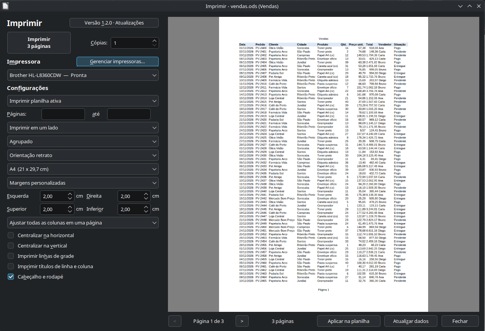
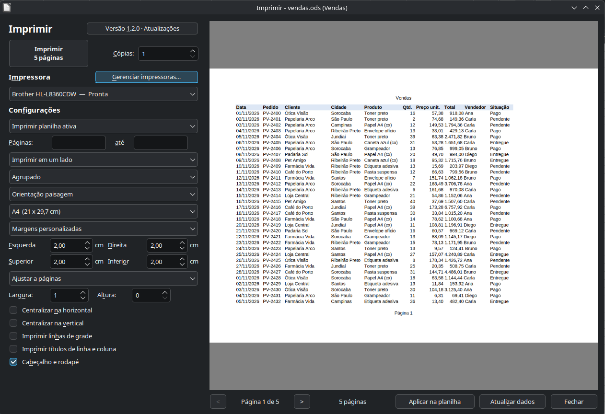

# Painel de impressão do Calc

Extensão para o **LibreOffice Calc** que traz o painel de impressão do Excel, com prévia em tempo real, e um botão para ajustar todas as colunas à largura da página.

Funciona em **Windows, macOS e Linux**, dentro do próprio LibreOffice, sem instalar mais nada.



## O que ela faz

- **Painel de impressão**: as configurações ficam à esquerda e a prévia à direita, atualizada a cada mudança. Você escolhe impressora, cópias, páginas, o que imprimir (aba atual, pasta inteira ou seleção), frente e verso, agrupamento, orientação, papel, margens e escala. A escala pode ser uma página, todas as colunas, todas as linhas, uma porcentagem ou um número de páginas.
- **Ajustar colunas à largura da página**: com um clique, todas as colunas da aba atual cabem na largura de uma página. As outras abas não mudam.
- **Aplicar na planilha**: guarda os ajustes na planilha sem imprimir, para usar depois.

A prévia é gerada a partir de uma cópia oculta da planilha. O arquivo original não muda, e o papel sai igual ao que aparece na tela.



## Baixar e instalar

1. Baixe o arquivo **PainelImpressaoCalc.oxt** na [última versão](https://github.com/edufigueiroa/PainelImpressaoCalc/releases/latest).
2. No LibreOffice, abra **Ferramentas > Gerenciador de extensões**, clique em **Adicionar** e escolha o arquivo.
3. Feche e abra o LibreOffice de novo.

Os dois botões aparecem na barra padrão do Calc, logo depois do botão de visualizar impressão:


O painel também fica no menu **Arquivo > Painel de impressão...**, e o ajuste em **Arquivo > Ajustar colunas à largura da página**.

### Requisitos

| Sistema | O que precisa |
|---|---|
| Windows | LibreOffice 7.0 ou mais novo. O Python já vem junto. |
| macOS | LibreOffice 7.0 ou mais novo. O Python já vem junto. |
| Linux | LibreOffice 7.0 ou mais novo, com o suporte a Python. Algumas distribuições separam esse suporte em outro pacote. |

Para instalar o suporte a Python no Linux:

```sh
sudo dnf install libreoffice-pyuno                       # Fedora
sudo apt install libreoffice-script-provider-python      # Debian, Ubuntu, Mint
sudo zypper install libreoffice-pyuno                    # openSUSE
```

As versões Flatpak e Snap do LibreOffice já trazem o Python.

### Impressão em cada sistema

- **Linux e macOS**: o painel envia o trabalho pelo sistema de impressão (CUPS). A opção de frente e verso aparece quando a impressora tem esse recurso.
- **Windows**: o painel imprime pelo próprio LibreOffice. Para frente e verso, deixe essa opção ligada nas preferências da impressora no Windows.

O botão **Gerenciar impressoras** abre as configurações de impressora do sistema.

## Atualizações

Quando sair uma versão nova:

1. Abra **Ferramentas > Gerenciador de extensões** e clique em **Verificar atualizações**.
2. Clique em **Instalar** e depois feche e abra o LibreOffice de novo.

O botão **Atualizações**, no alto do painel, também procura versões novas e abre o Gerenciador de extensões quando há uma.

> Quem tem a versão 1.1.2 ou anterior precisa baixar e instalar a versão nova uma vez pelo botão **Adicionar**. A partir da 1.1.3, as atualizações aparecem no Gerenciador de extensões.

## Compatibilidade testada

| Sistema | LibreOffice | Situação |
|---|---|---|
| Fedora Linux (KDE) | 26.2 | Testado: prévia, impressão, aplicar na planilha e atualizações |
| Windows | — | Ainda não testado |
| macOS | — | Ainda não testado |

Se usar no Windows ou no macOS, conte o resultado em [Issues](https://github.com/edufigueiroa/PainelImpressaoCalc/issues).

## Desenvolvimento

```
extension/
  description.xml              nome, versão e endereço das atualizações
  Addons.xcu                   menu Arquivo e botões da barra do Calc
  python/painel_impressao.py   painel e comandos (roda dentro do LibreOffice)
  icons/                       gerados pelo build.py
update.xml                     versão mais nova, lida pelo Gerenciador de extensões
build.py                       gera dist/PainelImpressaoCalc.oxt
install.sh                     gera e instala no LibreOffice (Linux e macOS, com o LibreOffice fechado)
docs/                          imagens deste README
```

O painel usa só o que vem com o LibreOffice:

- As janelas são do próprio LibreOffice.
- A prévia é um PDF da cópia oculta, aberto no Draw e convertido em imagem.
- A lista de impressoras vem do CUPS ou do LibreOffice.

Para lançar uma versão nova:

1. Aumente a versão em três lugares: `VERSION` em `extension/python/painel_impressao.py`, `version` em `extension/description.xml`, e `version` e o endereço do download em `update.xml`.
2. Gere o pacote e publique:

```sh
python3 build.py
git commit -am "Versão X.Y.Z" && git push
gh release create vX.Y.Z dist/PainelImpressaoCalc.oxt --title "vX.Y.Z" --notes "..."
```

O `update.xml` precisa estar no GitHub antes da release, porque é ele que avisa o LibreOffice. O GitHub pode levar alguns minutos para mostrar a versão nova.
